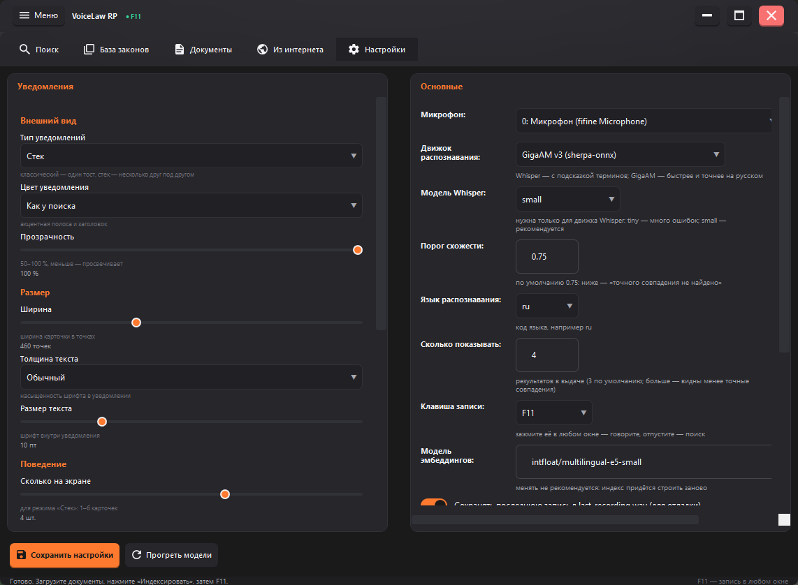

# VoiceLaw RP

Помощник для RP-ситуаций: говоришь фразу — программа распознаёт речь и находит нужные статьи. Работает офлайн, без интернета.

## Зачем это нужно

В RP-ситуациях некогда листать своды правил. Сказал «двенадцать восемь» или «хранение хлеба» — и сразу видно, что за статья и какое за неё наказание.

## Что умеет

- **Голосовой поиск** — распознаёт русскую речь (GigaAM или Whisper), понимает номера и формулировки.
- **Поиск по смыслу** — находит статьи, даже если в них нет точных слов запроса.
- **Наказание** — красным показывает срок или штраф по каждой статье, в таблице, в выдаче и в уведомлениях.
- **Уведомления** — всплывают поверх игры, режим «стек» показывает каждую статью отдельной карточкой; настраиваются: цвет, прозрачность, размер, время, положение.
- **База статей** — таблица, правка, экспорт/импорт CSV, обновление в один клик из папки `Baza` на GitHub.
- **Горячая клавиша и фоновый режим** — сворачивается в трей, поиск по клавише.

## Скачать

Готовый архив: **[Releases → v2.0.0](../../releases/latest)**

Файл `voice-law-rp-2.0.0-win64.zip`, около 308 МБ. Windows 10/11, 64 бита. Распакуйте и запустите `VoiceLawRP\VoiceLawRP.exe`.

## Первый запуск

База в архиве пустая — загрузите статьи сами:

1. **Обновить базу из GitHub** — на вкладке «Документы»; скачает статьи из папки `Baza` и соберёт поисковый индекс.
2. Либо вставьте ссылку на свод правил на вкладке «Из интернета».

## Скриншоты

## Обновление базы

Складываете CSV в папку `Baza` репозитория — у всех пользователей он подтянется по кнопке «Обновить базу из GitHub». Формат: заголовки на русском или английском, столбцы `Кодекс;Глава;Номер;Название;Текст` (или `code;chapter;article_num;title;text`).
