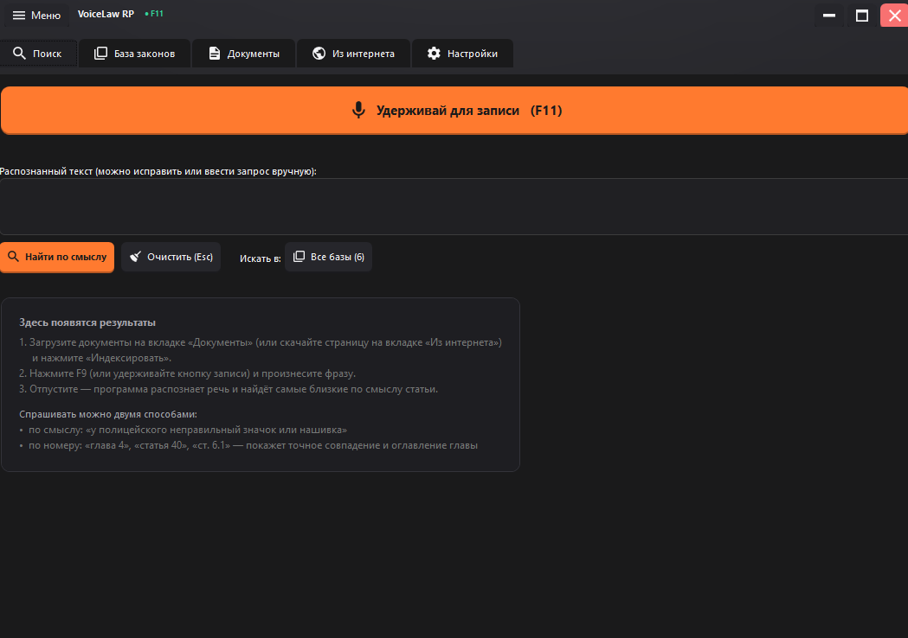
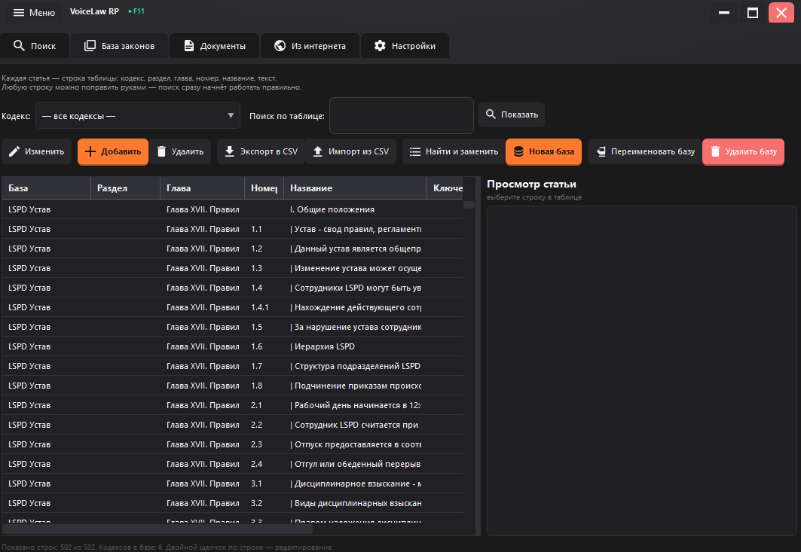
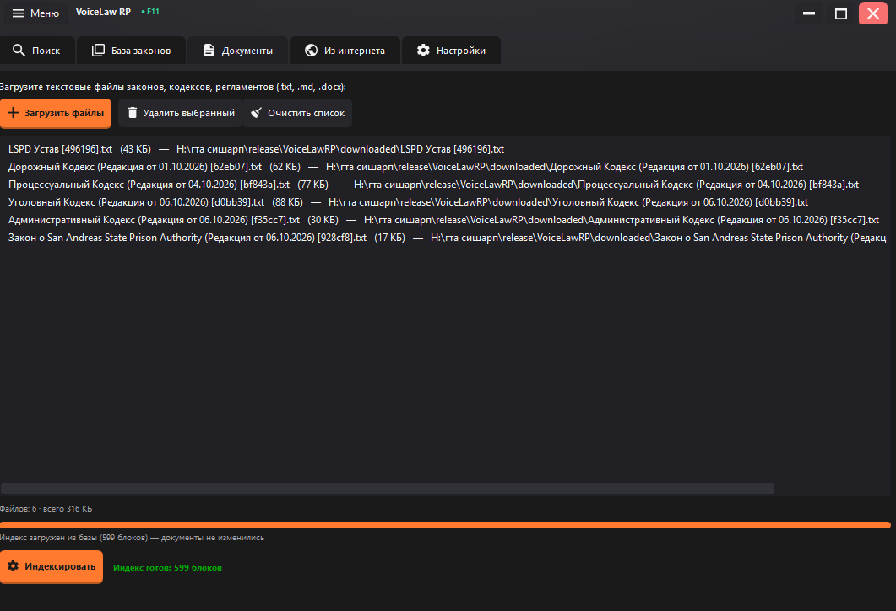
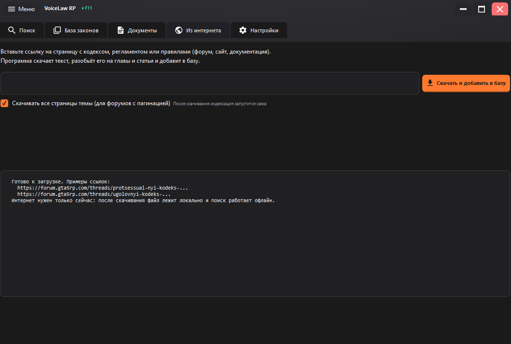
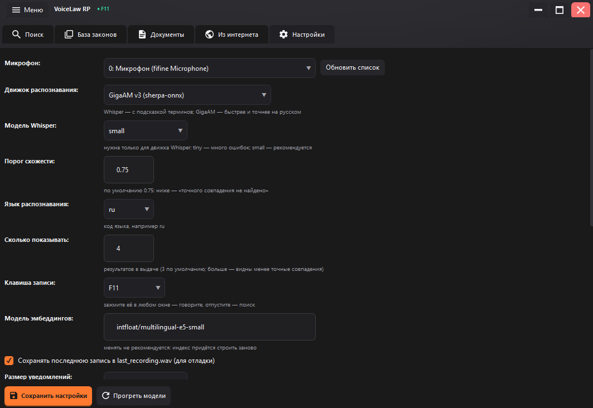
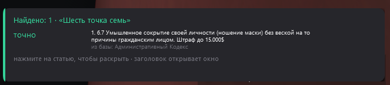

# VoiceLaw RP

Поиск по кодексам голосом — офлайн, без интернета.
Сказали фразу в микрофон — программа распознала речь и нашла нужные статьи.

## Скачать

Готовый архив: **[Releases → v2.0.0](../../releases/latest)**

Файл `voice-law-rp-2.0.0-win64.zip`, около 310 МБ.

## Как запустить

1. Распакуйте архив в любую папку.
2. Запустите `VoiceLawRP\VoiceLawRP.exe`.

Устанавливать ничего не нужно: среда выполнения, модели и кодексы уже внутри.
Нужна Windows 10 или 11, 64 бита.

В комплекте уже есть 6 кодексов, 502 статьи и готовый поисковый индекс —
индексировать и настраивать ничего не нужно.

---

## Окна программы

### 1. Поиск — главное окно



Что делать:

- Нажмите **F11** (или удерживайте большую оранжевую кнопку), скажите фразу
  и отпустите — текст появится в поле «Распознанный текст».
- Текст можно **поправить руками** или ввести запрос с клавиатуры и нажать
  **«Найти по смыслу»**.
- **«Очистить (Esc)»** — стереть запрос и результаты.
- **«Искать в: Все базы (6)»** — выбрать, по каким кодексам искать.
  Если выбрана только часть баз, над результатами появится предупреждение.
- Ниже появятся найденные статьи. Нажмите на строку, чтобы открыть статью.

Спрашивать можно двумя способами:

- **По смыслу:** «у полицейского неправильный значок или нашивка».
- **По номеру:** «статья 40», «шесть точка один», «двенадцать восемь», «глава 4».

### 2. База законов — таблица всех статей



Что делать:

- Слева выберите **кодекс** (или «все кодексы») и введите слово в
  **«Поиск по таблице»**, затем **«Показать»**.
- Щёлкните по строке — справа появится **просмотр статьи** целиком.
- Двойной щелчок по строке — **редактирование**.
- Кнопки сверху: **Изменить**, **Добавить**, **Удалить**, **Экспорт в CSV**,
  **Импорт из CSV**, **Найти и заменить**, **Новая база**, **Переименовать базу**,
  **Удалить базу**.
- Правки, сделанные здесь, попадают в поиск сразу.

### 3. Документы — откуда берутся статьи



Что делать:

- **«Загрузить файлы»** — добавить свои кодексы, уставы и регламенты
  (`.txt`, `.md`, `.docx`).
- В списке видно, какие файлы загружены, их размер и полный путь.
- **«Индексировать»** — разобрать документы на главы и статьи и построить поиск.
  Первый раз это занимает несколько минут.
- **«Перестроить заново»** — заново разобрать все документы и пересчитать индекс,
  даже если файлы не менялись. Обычная индексация в этом случае ничего не делает,
  и кажется, что кнопка не работает.
- **«Обновить базу из GitHub»** — забирает статьи из папки `Baza` репозитория
  и сразу пересобирает индекс. Документы переиндексировать не нужно.
- Внизу строка состояния: «Индекс загружен из базы (599 блоков) — документы
  не изменились». Если документы менялись, программа предложит пересчитать индекс.

### 4. Из интернета — скачать кодекс со страницы



Что делать:

- Вставьте ссылку на страницу с кодексом (форум, сайт, документация).
- Нажмите **«Скачать и добавить в базу»** — программа сама вытащит текст,
  разобьёт его на главы и статьи и добавит в базу.
- Галочка **«Скачивать все страницы темы»** нужна для форумов с пагинацией.
- **«Проверить обновления на форуме»** — программа смотрит раздел «Законодательная
  база» и сама скачивает новые редакции тех кодексов, что уже загружены.
  Например, если в программе Уголовный кодекс от 06.10.2026, а на форуме уже
  от 11.10.2026 — он скачается, заменит старый и индекс пересоберётся.
- Интернет требуется только на время скачивания. Дальше всё работает офлайн.

### 5. Настройки



Что можно поменять:

- **Микрофон** — выберите устройство, если микрофонов несколько.
- **Движок распознавания** — GigaAM v3 (быстрее и точнее на русском) или Whisper.
- **Модель Whisper** — `tiny` быстро, но с ошибками; `small` рекомендуется.
- **Порог схожести** — 0.75 по умолчанию; ниже — «неточное совпадение».
- **Язык распознавания** — код языка, например `ru`.
- **Сколько показывать** — число статей в выдаче (по умолчанию 4).
- **Клавиша записи** — F11 по умолчанию. Работает в любом окне.
- **Модель эмбеддингов** — менять не рекомендуется: индекс придётся строить заново.
- **Размер уведомления**, **время показа**, **текст в уведомлениях**.
- **«Сохранить настройки»** — применить. **«Прогреть модели»** — заранее
  загрузить модели, чтобы первый голосовой запрос был быстрым.

### 6. Уведомление с результатом



Что это:

- Когда программа свёрнута или вы в игре, результат показывается всплывающей
  карточкой в правом нижнем углу основного экрана.
- **Щелчок по строке** — раскрыть статью прямо в уведомлении.
- **Щелчок по заголовку** — открыть окно программы с этим результатом.
- Размер и время показа настраиваются на вкладке «Настройки».

---

## Что внутри архива

```
VoiceLawRP\
    VoiceLawRP.exe          — программа
    models\                 — распознавание речи и поиск
    downloaded\             — 6 кодексов
    laws.db                 — база статей (502)
    index_*.npz / .json     — готовый поисковый индекс
    settings.json           — настройки (пути относительные)
    synonyms.txt            — синонимы для поиска
```

Переносить комплект можно в любую папку — пути внутри относительные.

## Требования

- Windows 10 или 11, 64 бита
- Микрофон (для голосового поиска)
- Интернет не нужен

## Исходный код

Программа распространяется только в виде готовой сборки. Исходный код не публикуется.

## Проверка версии

```
VoiceLawRP.exe --check
```
